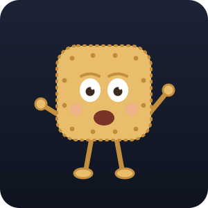
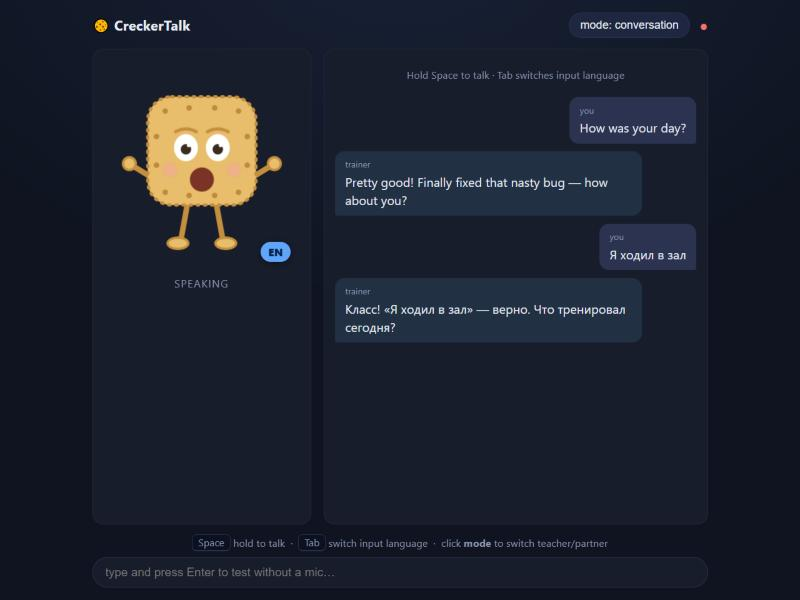

<h1 align="center">🍪 CreckerTalk</h1>

<p align="center">
  <b>A local voice trainer for English.</b><br/>
  Talk to a cracker character — it replies by voice, fixes your mistakes and explains grammar. Fully offline.
</p>

<p align="center">
  <b>English</b> · <a href="README.ru.md">Русский</a>
</p>

<p align="center">
  
</p>

<p align="center">
  
  
  
  
  
</p>

> ⚠️ **Work in progress.** The core loop works, but the UI, features and settings still change. Feedback is welcome.

<p align="center">
  
</p>

---

## 🎯 What is it

A voice conversation partner for practicing English that runs **entirely on your machine**:

- 🎙️ **Talk by voice** — browser microphone, live speech recognition.
- 🗣️ **Replies by voice** — an animated cracker, **Крекер**, with real lip-sync (the mouth moves with the audio).
- ✍️ **Fixes your mistakes** as you chat.
- 📚 **Explains grammar** on request (teacher mode).
- 🌍 **Mirrors your language** — write/speak Russian → it answers in Russian; English → English.
- 🔒 **Private** — no cloud. LLM via Ollama, speech on CPU.

## 🧩 How it works

```
Browser (mic, Web Audio, Крекер)
   │  WebSocket (audio ⇄ audio)
   ▼
app container (CPU):  VAD → STT (faster-whisper) → orchestrator → Ollama → TTS → browser
                                          ▲
                                  Ollama (native on host, uses the GPU)
```

- **LLM** — Ollama, installed natively on the host (grabs your GPU).
- **STT** — faster-whisper (CPU). **TTS** — Kokoro for English / Piper for Russian (CPU).
- Everything lives in `.env`. Moving to another PC = clone → edit `.env` → `docker compose up`.

## 🍪 The character

Meet **Крекер** — a cracker with eyes, arms and legs. It reacts to what's happening:

| State | What it does |
|---|---|
| `idle` | stands, blinks, gentle bob |
| `listening` | raises its arms (while you record) |
| `thinking` | thinks — dots above its head, looks up |
| `speaking` | mouth moves **with the real voice** (lip-sync) |

## 🚀 Quick start

**One-time:** install **[Docker Desktop](https://www.docker.com/products/docker-desktop/)** and **[Ollama](https://ollama.com/download)**.

**Windows:**
```powershell
git clone https://github.com/Crecker76/crecker-talk.git; cd crecker-talk; .\start.ps1
```

**macOS / Linux:**
```bash
git clone https://github.com/Crecker76/crecker-talk.git && cd crecker-talk && ./start.sh
```

The script copies `.env`, pulls the model (`ollama pull`), builds & starts the container, and opens the app at **http://localhost:8000** — use `localhost`, the mic needs a secure context.

> **Linux:** run Ollama so the container can reach it: `OLLAMA_HOST=0.0.0.0 ollama serve`.

<details>
<summary>…or manually</summary>

```bash
ollama pull dolphin3:8b
cp .env.prod.example .env            # copy .env.prod.example .env  on Windows
docker compose up -d --build
```
</details>

## 🎮 Controls

| Action | What it does |
|---|---|
| Hold **Space** | talk (push-to-talk) |
| **Tab** | switch input language EN ⇄ RU |
| **mode** button | role: chat partner ⇄ grammar teacher |
| text field + **Enter** | test without a microphone |

## 🧠 Choosing a model

Reply quality depends on the LLM (`OLLAMA_MODEL` in `.env`).

**Switch model:** `ollama pull <model>` → edit `OLLAMA_MODEL` in `.env` → `docker compose up -d --force-recreate`.

**Memory footprint (Q4)** ≈ `params × 0.6 GB` + context:

| Model | ~memory (Q4) |
|---|---|
| 3B | ~2 GB |
| 7B | ~4.5 GB |
| 8B | ~5 GB |
| 14B | ~9 GB |
| 32B | ~20 GB |

Check how it loaded (GPU vs CPU): `ollama ps` (`100% GPU` = fully on the card).

**By hardware:**

| Hardware | Recommended | Notes |
|---|---|---|
| **GTX 1050 Ti · 4 GB VRAM** | `dolphin3:8b` | 8B fits with partial CPU offload; the 4 GB ceiling is ~7–8B |
| 4 GB, want speed | `llama3.2:3b`, `qwen2.5:3b` | 3B fully on the GPU |
| 6–8 GB VRAM | `dolphin3:8b`, `qwen2.5:7b` | 8B fully on the GPU |
| 12 GB+ VRAM | `qwen2.5:14b`, `mistral-nemo` | noticeably smarter |
| 16 GB+ VRAM | `qwen2.5:32b` (Q4) | best local quality |
| CPU-only | `llama3.2:3b` | 7–8B work too, just slower |

**Good picks:** uncensored — `dolphin3:8b` ⭐, `dolphin-mixtral`; strong instruct — `qwen2.5`, `llama3.1:8b`, `mistral-nemo` (12B), `gemma2:9b`. Avoid "thinking" models (`qwen3`, `deepseek-r1`) for voice — they emit `<think>…</think>`.

## 🩹 Troubleshooting

- **`LLM call failed`** — the model in `.env` isn't pulled (`ollama list`) or doesn't fit in memory. Use a smaller model or free RAM/VRAM.
- **Mic doesn't work** — open `http://localhost:8000` (not `0.0.0.0` or an IP) — a secure context is required.
- **Out of VRAM** — switch to a 3B model or lower `OLLAMA_NUM_CTX`.
- More details in the comments of `.env.dev.example` / `.env.prod.example`.

## 🛠️ Status & roadmap

**Work in progress.** Done: end-to-end voice loop, lip-sync, two modes, language mirroring, a learning
syllabus and SQLite progress. Planned: richer character animation, better Russian TTS, in-UI settings.

## 📄 License

[MIT](LICENSE) © Crecker76

---

<p align="center"><i>Made for fun, with a cookie. 🍪</i></p>
